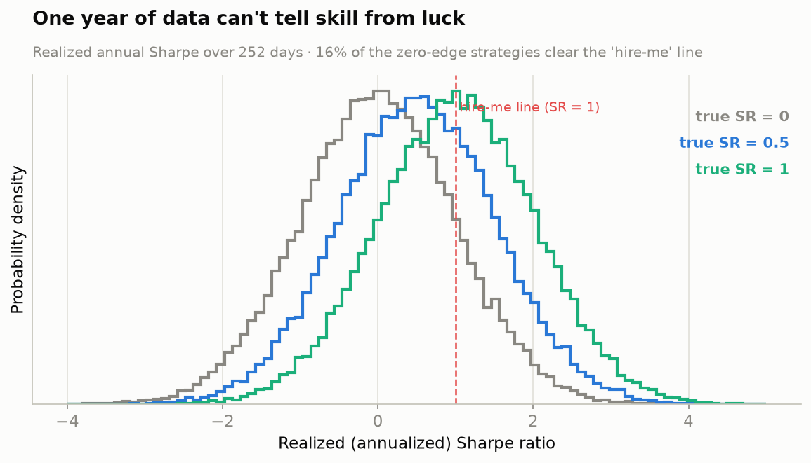
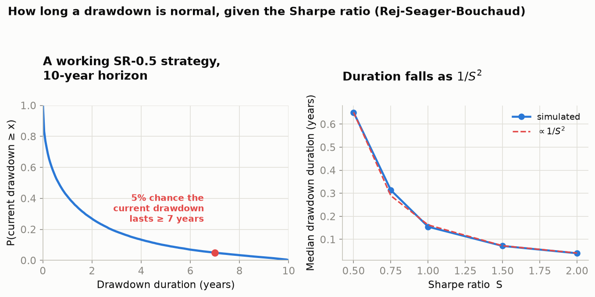
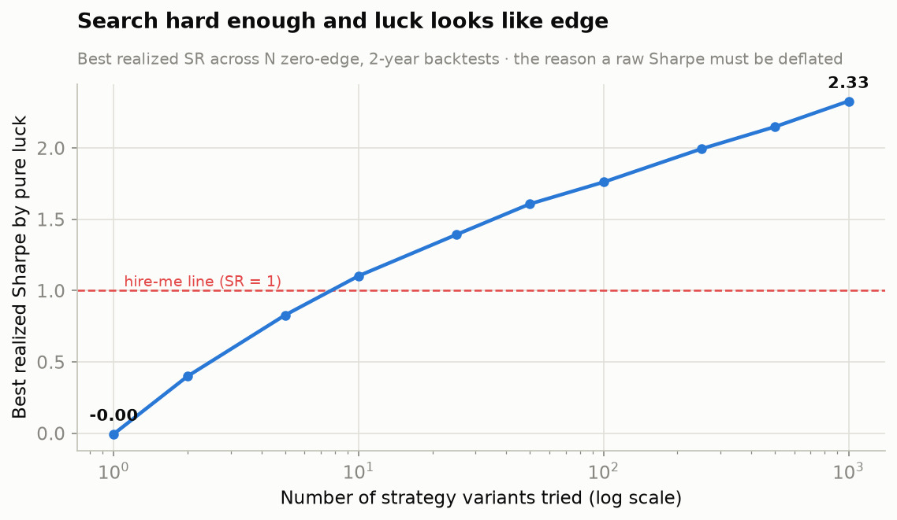

# The Sharpe Ratio Illusion

### A coin-flip strategy can walk in with a Sharpe of 2. A genuinely great one can sit in a drawdown for seven years. It's the same fact, seen from two sides.

---

The Sharpe ratio is the number the whole industry runs on. Allocators screen on it,
managers are hired and fired on it, backtests are ranked by it. It has one job:
tell skill apart from luck by dividing how much you earned by how much you bounced
around earning it.

The problem is that, over the track records we actually have — months, a few years —
it is mostly **measuring the bounce, not the skill**. This piece shows what that
looks like, why it happens, and what to report instead. Every chart comes from a
tiny simulation library; the code is linked at the end so you can rerun all of it.

## The setup

The Sharpe ratio is

$$ SR = \frac{\text{average return} - \text{risk-free}}{\text{volatility of returns}} $$

usually annualized. A Sharpe of 1 is a good systematic strategy; 2 is excellent; above
that people start naming buildings after you.

To study it honestly we do the one thing you can never do with a real track record:
**fix the truth and look at the estimate**. We generate return streams whose *true*
Sharpe ratio is exactly 0, 0.5, or 1, run thousands of them, and watch what the
*measured* Sharpe does. If the measured number reliably recovered the truth, the story
would end here. It doesn't.

## Illusion #1 — a year of data can't tell 0 from 1

Here are the realized one-year Sharpe ratios for three populations: a **pure coin flip**
(true SR = 0), a decent strategy (0.5), and an excellent one (1.0).

The three clouds sit almost on top of each other. **16% of the zero-edge strategies —
one in six literal coin flips — post a realized Sharpe above 1.0 over a full year**, the
threshold that gets a manager hired. Plenty clear 2. Nothing is wrong with them; they
just got a good year. Point at any single strategy on the right-hand side of this chart
and you cannot say whether it has an edge or a tailwind.

## Illusion #2 — a great strategy that stays in the hole for years

Now the mirror image, and this one has an exact theory behind it. Rej, Seager and
Bouchaud at Capital Fund Management asked the question every manager in a losing streak
is really asking — *"You are in a drawdown; when should you start worrying?"* — and
answered it with the exact distributions for the **depth** and **duration** of a
drawdown under a given Sharpe ratio.

Model the PnL as a drifting random walk and normalize the volatility to 1, so the drift
*is* the Sharpe ratio (`S = μ`). Two clean scaling laws fall out:

- a typical drawdown's **depth** scales as **`1/S`**,
- its **duration** scales as **`1/S²`**.

The duration is the brutal one: it goes as the *inverse square* of the Sharpe. Halve the
Sharpe and you don't double the expected time in the hole — you **quadruple** it. This
is the real reason drawdowns feel interminable, and it is why both managers and
investors chronically underestimate them.

Put numbers on it. For a genuinely good strategy — true Sharpe 0.5 — watched over 10
years, our simulation reproduces the paper's headline result exactly: **there is a 5%
chance the drawdown you are currently sitting in has already lasted 7 years or more.**
Seven years, with a real, positive edge, and nothing broken. In the real world that book
is closed at year two and the edge is never collected.

*(Two related but distinct objects are worth separating. Bouchaud studies the* current
*drawdown — how long the hole you're in right now is likely to be. A different classic
result, Magdon-Ismail et al. (2004), gives the expected* maximum *drawdown over a whole
horizon; that one is also in the repo as a closed form. This piece uses the current-
drawdown view because it matches the question a manager actually asks.)*

## Why both happen: the √T wall

Both illusions are the same piece of arithmetic. The signal-to-noise of a track record —
the t-statistic on its average return — is

$$ t = SR \times \sqrt{T} $$

The edge (`SR`) is fixed by the strategy. The only way to accumulate statistical
confidence is to accumulate **time**, and it comes in as a *square root*. To double your
certainty you need four times the data. The estimation error around a Sharpe ratio
shrinks only as `1/√T`, which is agonizingly slow.

The same tension explains Bouchaud's `1/S²`. The edge adds up in proportion to `S·T`,
while the random swings grow only as `√T`. The edge doesn't reliably dominate the noise
until `S·T ≳ √T`, i.e. until `T ≳ 1/S²` — which is exactly the timescale of a typical
drawdown. Estimation error and drawdown duration are two faces of the same race between
signal and noise.

## So how long *do* you need?

Turn the equation around and ask how much daily data it takes before you can be 97.5%
confident a strategy's true Sharpe is even *positive* (this is Bailey & López de Prado's
**Minimum Track Record Length**):

A genuinely good strategy at **Sharpe 0.5 needs about 15 years** of daily data before its
track record clears the bar. A quarter-Sharpe strategy — still worth money — needs a
human lifetime. Only the rare Sharpe-2 machine can prove itself inside a year. Almost
every track record you will ever evaluate is **too short to trust on the Sharpe ratio
alone**. That is not a data-quality problem you can fix; it is the geometry of the
estimator.

## The trap that makes it worse: searching

Everything above assumed you tested *one* strategy. Nobody tests one strategy. You try
variations — parameters, universes, filters — and report the best. Watch what that does,
using nothing but zero-edge coin flips:

Every strategy on this chart has **zero real edge**. Yet trying just **10 variants**
already hands you a best-of-batch Sharpe above the hire-me line, and searching **1,000 of
them buys a Sharpe above 2 — from pure noise**. This is why a backtest's headline Sharpe
is close to meaningless without knowing how many configurations were tried to find it. It
is also the core of Marcos López de Prado's argument that most published backtests are
selection-bias artifacts.

## What to report instead

The fix is not to abandon the Sharpe ratio but to stop reporting it naked. The literature
gives three concrete upgrades, all implemented in the repo:

1. **Never show a Sharpe without its sample size** — and ideally its standard error.
   `SE(SR) ≈ √((1 + ½·SR²)/n)` (Lo, 2002). The number without `n` is not interpretable.
2. **Report the Probabilistic Sharpe Ratio (PSR)** — the *probability* the true Sharpe
   beats a threshold, given your sample length **and the shape of your returns**. Negative
   skew and fat tails (the profile of every "sell insurance" strategy that looks great
   until it doesn't) push this probability *down* even when the point estimate looks great.
3. **Deflate for your search — the Deflated Sharpe Ratio (DSR)** — judge the winning
   backtest not against zero but against the best Sharpe you'd *expect from luck* given how
   many strategies you tried. The more you searched, the higher the bar.

## The honest caveat

Everything here used clean, well-behaved Gaussian returns — the *friendliest* possible
case. Real returns have fat tails, volatility clustering, and serial correlation, all of
which make the estimation error **larger**, not smaller. The illusion shown here is the
optimistic version.

None of this makes the Sharpe ratio useless. It makes it a **noisy estimate that has to
be reported like one** — with its sample size, its distribution, and an honest count of
how hard you searched. A number that can be manufactured by a coin flip in a good year
deserves exactly that much skepticism.

---

*Code and all figures are reproducible from the open-source repo:
[SharpeRatioIllusion](https://github.com/edoardoanfelli/SharpeRatioIllusion). Simulations
use `numpy`; the Sharpe standard error, PSR, DSR and MinTRL are implemented from the
papers below.*

**Sources**

- Lo, A. W. (2002). *The Statistics of Sharpe Ratios.* Financial Analysts Journal 58(4).
- Rej, A., Seager, P., & Bouchaud, J.-P. (2017). *You are in a drawdown. When should you
  start worrying?* Capital Fund Management.
- Bailey, D. H., & López de Prado, M. (2012). *The Sharpe Ratio Efficient Frontier.*
  Journal of Risk 15(2).
- Bailey, D. H., & López de Prado, M. (2014). *The Deflated Sharpe Ratio.* Journal of
  Portfolio Management 40(5).
